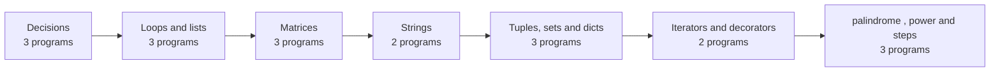

<h1 align="center">vglug-tasks</h1>
<p align="center"><b>Python, one program at a time.</b><br>
Weekly exercises from my Python with agentic AI course at VGLUG Foundation.</p>

<p align="center">
<a href="https://saravanan2006-coder.github.io/vglug-tasks/"></a>


</p>

Every program has a live version you can run in the browser on the [live page](https://saravanan2006-coder.github.io/vglug-tasks/). Two new programs are added each week.

## Learning path



## Decisions

| Program | What it does | Concepts |
| --- | --- | --- |
| [`EB_Bill.py`](EB_Bill.py) | Turns two meter readings into units used and a bill at 5 per unit. | `if / else`, `arithmetic` |
| [`loan_eligibility.py`](loan_eligibility.py) | Checks age, credit score and monthly income before approving a loan. | `nested if`, `elif` |
| [`scholarship_eligibility.py`](scholarship_eligibility.py) | Needs marks of 75 or more and attendance of 95 percent or more. | `nested if`, `comparison` |

## Loops and lists

| Program | What it does | Concepts |
| --- | --- | --- |
| [`ATM_withdrawal_system.py`](ATM_withdrawal_system.py) | Withdraw from a 10000 balance until it runs out or the amount is too high. | `while loop`, `input` |
| [`shopping.py`](shopping.py) | Adds up the prices of five items into one total. | `for loop`, `accumulator` |
| [`duplicate.py`](duplicate.py) | Finds roll numbers that appear more than once in a list. | `nested loops`, `lists` |

## Matrices

| Program | What it does | Concepts |
| --- | --- | --- |
| [`addmatrix.py`](addmatrix.py) | Adds two 2x2 matrices cell by cell. | `nested lists`, `nested loops` |
| [`matmul.py`](matmul.py) | Multiplies two 2x2 matrices with a triple loop. | `nested lists`, `three loops` |
| [`transpose.py`](transpose.py) | Flips a 2x3 matrix into a 3x2 matrix. | `nested lists`, `indexing` |

## Strings

| Program | What it does | Concepts |
| --- | --- | --- |
| [`palindrome.py`](palindrome.py) | Tests a word and a number by comparing them with their reverse. | `slicing`, `str()` |
| [`functions.py`](functions.py) | Pick one: repeated letters, substring search, or a letter count. | `functions`, `menu` |

## Tuples, sets and dicts

| Program | What it does | Concepts |
| --- | --- | --- |
| [`overlap.py`](overlap.py) | Finds the longest tuple in a group of three. | `tuples`, `len()` |
| [`project.py`](project.py) | Lists the people who work on both projects. | `sets`, `intersection` |
| [`studen_dictionary.py`](studen_dictionary.py) | Prints each student's department, year and total marks. | `nested dict`, `sum()` |

## Iterators and decorators

| Program | What it does | Concepts |
| --- | --- | --- |
| [`iterator.py`](iterator.py) | Walks through a name one letter at a time. | `iter()`, `next()` |
| [`decorator.py`](decorator.py) | Wraps a greeting function and repeats it as many times as you ask. | `decorators`, `closures` |

## palindrome , power and steps

| Program | What it does | Concepts |
| --- | --- | --- |
| [`num_palindrome.py`](num_palindrome.py) | checks weather the given input number is a palindrome or not.  | `recusrion`, `operators` |
| [`steps.py`](steps.py) | Count how many steps are required to make a number zero.  | `loops`, `conditional statements` |
| [`power.py`](power.py) | check whether a given number is a power of 2. | `function` |

## Run a program

```bash
git clone https://github.com/saravanan2006-coder/vglug-tasks.git
cd vglug-tasks
python3 EB_Bill.py
```

<!-- ## Add this week's programs

<details><summary>Three steps</summary>

1. Save the new `.py` files in the repo and add one entry each to `programs.json`.
2. Run `python build.py` to refresh `programs.js` and this README.
3. Commit and push. The live page updates itself.

</details> -->
